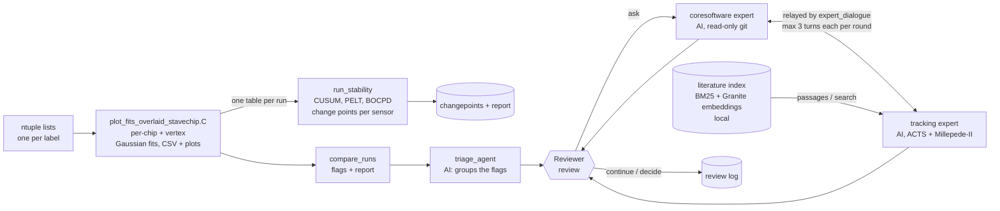
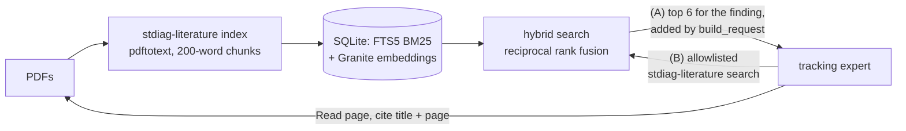

# SAGA: Silicon Alignment with Generative Agents

**Automated chip-by-chip (sensor level for INTT) track residual diagnostics
for different alignment iterations along with an Agentic AI framework for
assisting in root-cause analysis**

This framework measures the drift of sensors of the sPHENIX silicon tracker
(MVTX and INTT) across different runs, alignment iterations and software
updates and investigates the cause of the drifts. Deterministic,
reproducible statistical tests flag the sensor drifts and record details in a
CSV file. A team of AI agents then uses the CSV file to investigate the root
cause: a triage agent (tool use) groups the flags into findings, a
coresoftware expert (agentic search) traces the residuals back from
`MakeMilleFiles.cc` through the code they depend on and searches those
changes in the commit history for one that explains them, and a tracking expert
(agentic RAG) checks each hypothesis against the ACTS and Millepede-II
documentation, using the alignment literature of other experiments (searched
locally) as supporting evidence. The result is a set of ranked, evidence-backed hypotheses, each with a concrete
test the reviewer can run to confirm it.

## Overview

### Motivation

- **Alignment determines tracking quality.** Track momentum, DCA and
  vertexing depend strongly on the position of the sensors relative to the
  ideal geometry, and their position and orientation must be accounted for
  at the micrometer level. A sensor displaced from its assumed position
  biases every track that crosses it.
- **Manual inspection is the bottleneck.** Each
  production (an alignment iteration, a run or a software build) yields 1550
  residual distributions: 432 MVTX chips and 224 INTT sensors in two
  coordinates (1312), 104 stave and ladder aggregates (208), and 30
  track-to-vertex distributions, or about 3100 means and widths in total. The
  software that produces them (`coresoftware`, ACTS, Millepede-II) changes
  frequently. Therefore manually inspecting the changes is time consuming,
  labor intensive and error-prone.

### What is measured

- **Residual.** For each hit, the residual is the measured position minus
  the position predicted by the fitted track (`localMeas − localState` in
  `ActsAlignmentStates.cc`), in the sensor's two local coordinates (r-φ
  and z).
- **Expected behaviour.** For a well-aligned sensor, the residual
  distribution is centred at zero and its width reflects the detector's
  intrinsic resolution (MVTX pixels of about 27 × 29 µm; INTT strips with
  78 µm pitch, 16 or 20 mm long) combined with the track's own uncertainty.
  The track-to-vertex residuals (−DCA_xy, −DCA_z) should be centred at zero
  and independent of track direction (φ).
- **Drift detection.** Relative to a reference production, a sensor is
  flagged when its mean shifts by more than 1.96 standard errors *and* by
  more than a physically meaningful minimum (MVTX 5 µm; INTT 20 µm in r-φ and
  1 mm in z; vertex 10/20 µm), or when its width changes by more than 10%
  with a significance above 3 (exact tests in
  [Fits and flagging criteria](#fits-and-flagging-criteria)).
  Widths and means can be compared between runs, productions and alignment
  iterations, or between data and simulation. A shift in the mean reveals a
  sensor displacement, and a change in width reveals a change in resolution.

### Design

- **Deterministic core.** Fitting (ROOT macro), comparison and flagging
  (`stdiag.compare_runs`), validation of the triage output against the
  flags, orchestration of the agents, and run-by-run monitoring are all
  fixed and determinstic code with fixed thresholds. They are reproducible, configurable, run locally, and
  do not use AI. This makes the drift detection robust against AI hallucinations, data manipulations and keeps the flags manually verifiable.
- **Agentic root-cause analysis.** Three read-only Claude agents with
  distinct architectures:
  - **Triage (tool use).** Calls read-only functions over the comparison
    tables (with `--backend claude-code`, receives their outputs in one
    prompt instead), groups the flags into coherent findings such as chip-,
    stave- or layer-level misalignments, and returns structured JSON that
    code validates against the flags.
  - **Coresoftware expert (agentic search).** Searches only the code that
    produces the `ntp` residuals: tier 1 is
    `offline/packages/TrackerMillepedeAlignment/`, tier 2 the files
    `MakeMilleFiles.cc` includes and the modules that fill the nodes it
    reads (fit and alignment states, measurement errors, geometry and
    alignment transforms, MVTX/INTT clusters, tracks, vertices). The
    commits of the range in each tier are listed by `git log` before Claude
    is called. It reads tier 1 first, traces back into tier 2 where the
    finding points, with read-only Read, Grep, Glob and git commands, and
    proposes ranked hypotheses citing the responsible commit, file and line,
    or says the reason could not be found from those changes.
  - **Tracking expert (agentic RAG).** Receives the literature passages
    retrieved for the finding (local hybrid BM25 + embedding search), can
    run that search itself, and also searches the ACTS and Millepede-II
    documentation and the code. It checks each hypothesis against the
    documentation and code, with the literature as supporting evidence
    ([Literature retrieval](#literature-retrieval-for-the-tracking-expert)).

  The two experts verify each other's claims in a dialogue routed by fixed
  Python code. Each hypothesis comes with a check to confirm it; the human
  reviewer team then confirms it and uses the AI suggestions to plan the
  next step.
- **Time-series monitoring.** Given one fit table per run, each sensor's
  residual mean and width form a time series. Three complementary
  change-point methods (CUSUM, PELT and Bayesian online change-point
  detection) identify the runs where a sensor, stave or layer moved or its
  resolution changed, and distinguish layer-wide (common-mode) shifts from local
  ones. See [Run-by-run stability](#run-by-run-stability).

### Evaluation

Synthetic data with known, injected changes were used for evaluation. Details are in
[Evaluation layer](#evaluation-layer).

- **Fitting and comparison:** every row matches the injected truth
  (1312/1312 across 20 random seeds; 1550/1550 end to end from simulated
  ROOT files across 9 seeds).
- **Run-by-run monitoring:** 30/30 scenarios pass. That is 15 series with 15
  injected effects each, including decoys that must not be flagged, plus 15
  series with no changes, which produce zero detections.
- **Agent infrastructure:** output validation and orchestration are covered
  by unit tests with scripted agent responses, run in CI.
- **AI triage:** all 21 synthetic cases were grouped correctly in a live run
  (one repetition each, `claude-opus-5-5`), so at 95% confidence the pass
  rate is at least 84%. A second repetition of 7 key cases gave identical
  findings.

## Architecture



The fit, comparison and run-by-run stability steps use no AI and never leave
the machine. The
triage and the experts are Claude agents. Routing, turn limits and stopping
are fixed Python code (`stdiag/review.py`, `stdiag/expert_dialogue.py`); the
agents never decide which agent runs next, and the reviewer approves every
extra round and makes the final decision. The literature index is built and
searched locally; the tracking expert receives passages in its request and
may run one allowlisted, read-only search command.

## Repository layout

```
macros/      ROOT: plot_fits_overlaid_stavechip.C (fits -> CSV tables, and plots)
stdiag/      Python package: compare_runs, run_stability, triage_agent,
             review, coresoftware_expert, tracking_expert,
             expert_dialogue, fetch_tracking_docs, literature, paths
maps/        coresoftware_code_map.md, tracking_docs_map.md, labels.example.csv
synthetic/   synthetic data with injected changes: ROOT ntuples
             (make_synthetic_ntp.C) and fit tables, truth check,
             run_full_pipeline.sh, run_test.sh, reference/ outputs,
             example reports; stavechip_demo/ (one stave and one
             ladder, every step by hand); make_synthetic_run_series.py
             and check_run_stability.py (60-run series for run_stability)
notebooks/   run_stability_synthetic.ipynb (change-point methods on the
             synthetic run series; outputs in notebooks/output/, local only)
tests/       pytest suite (no AI calls)
evals/       evaluation layer for the AI agents (see evals/README.md)
docs/        literature_rag.md (design of the literature retrieval);
             TrackingLiterature/ alignment papers and talks (PDFs, local only)
inputs/      residual_fits_<name>.csv tables to compare (local only;
             one synthetic example pair is committed)
runs/        one folder per comparison, <a>_vs_<b> (local only)
```

## Install and configure

```bash
# Next two lines optional but recommended: virtual environment
python3 -m venv .venv
source .venv/bin/activate

python -m pip install --upgrade pip
pip install -e ".[dev]"
git clone https://github.com/millepede-project/millepede-ii.git docs/Millepede/millepede-ii
python -m stdiag.fetch_tracking_docs --update-acts
cp maps/labels.example.csv labels.csv
```

This creates a virtual environment in `.venv/` (git-ignored), activates it,
and installs the package and pytest into it; it needs Python 3.10 or newer
(`python3 --version`). Run `source .venv/bin/activate` again in every new
terminal, and `deactivate` to leave it. Use `".[dev,api]"` to add the
Anthropic API triage backend. The clone and fetch lines build the ACTS
45.0.0 and Millepede-II V05-01-08 snapshot in `tracking_docs/` for the
tracking expert (below), and the last line creates a `labels.csv` to fill
in with the configuration of each label: `coresoftware_commit` (the
version the label's ntuples were built from), `cdb_tag`, `alignment_file`,
`macro_version`, `local_diff` (optional: path, relative to `labels.csv`, to
a `git diff` of local edits the build had beyond its commit) and `notes`.

The tracking expert has no network access, so its ACTS and Millepede-II
sources are a local snapshot in `tracking_docs/`, built once and refreshed
only when you ask:

- **Millepede-II** is read from the local clone in `docs/Millepede/`
  (git-ignored) at the release tag V05-01-08, with `git show`, so the
  clone's checked-out commit and any local edits do not matter. The
  snapshot holds the draft manual (`draftman_page.txt`, section labels as
  `{#label}`), the other documentation pages and the `pede` source. The
  GitHub repository mirrors DESY's; check the tag once against DESY GitLab,
  the two hashes must be equal:

  ```bash
  git -C docs/Millepede/millepede-ii rev-parse V05-01-08
  git ls-remote https://gitlab.desy.de/millepede/millepede-ii.git refs/tags/V05-01-08
  ```

- **ACTS** is downloaded from the sPHENIX fork only with `--update-acts`
  (pin a commit with `--acts-ref <full hash>`); without it the script
  rebuilds only the Millepede-II part and keeps the ACTS copy.

`python -m stdiag.fetch_tracking_docs --check` reports what the snapshot
holds, offline. Another Millepede-II release: `--millepede-ref <tag>`.

The AI steps use the Claude Code CLI (`claude`, logged in). These locations
can be set with environment variables:

| Variable | Default | Used by |
|---|---|---|
| `STDIAG_CORESOFTWARE` | `../coresoftware` next to this repository | coresoftware and tracking experts |
| `STDIAG_TRACKING_DOCS` | `tracking_docs/` in this repository (git-ignored) | tracking expert |
| `STDIAG_MILLEPEDE_REPO` | `docs/Millepede/millepede-ii` (git-ignored) | `fetch_tracking_docs`, which builds the Millepede-II part of the snapshot from this clone |
| `STDIAG_RUNS_DIR` | `runs/` in this repository (git-ignored) | `compare_runs`, which creates `<a>_vs_<b>/` folders there |
| `STDIAG_CLONES_DIR` | `runs/_clones/` in this repository (git-ignored) | `review.py ask` and the coresoftware expert eval: one range clone per pair of versions (about 40 MB each, a few seconds to make) |

`coresoftware` is not part of this repository; point the variable to the local coresoftware checkout of https://github.com/sPHENIX-Collaboration/coresoftware (full history needed for the experts).

### Alignment literature for the tracking expert (optional)

Put the alignment papers and talks (PDFs) in `docs/TrackingLiterature/`
(git-ignored), then build the local search index. How it works:
[Literature retrieval](#literature-retrieval-for-the-tracking-expert) and
[`docs/literature_rag.md`](docs/literature_rag.md).

```bash
brew install poppler ollama           # pdftotext, local model server
brew services start ollama
ollama pull granite-embedding:30m
stdiag-literature index               # first run: all files; later: only new or changed ones
stdiag-literature search "twist weak mode mass constraint"
stdiag-literature status
```

Rerun `stdiag-literature index` after adding, changing or removing PDFs; it
processes only what changed.

| Variable | Default | Used by |
|---|---|---|
| `STDIAG_LITERATURE_DIR` | `docs/TrackingLiterature/` | `stdiag-literature index` |
| `STDIAG_LITERATURE_INDEX` | `literature_index/literature.sqlite` (git-ignored) | `stdiag-literature`, tracking expert |
| `STDIAG_EMBED_MODEL` | `granite-embedding:30m` | `stdiag-literature` |
| `STDIAG_OLLAMA_URL` | `http://localhost:11434` | `stdiag-literature` |

## Input format

The `macros/plot_fits_overlaid_stavechip.C` macro reads the ROOT files
containing the `ntp` and `track_ntp` trees. They are listed in plain-text list
files, one file name per line, given as `list:label` pairs (e.g.
`ntuple_list1.txt:Iter0,ntuple_list2.txt:Iter1`; the first is the
reference). Each file needs the trees that
`offline/packages/TrackerMillepedeAlignment/MakeMilleFiles.cc` writes.

| Tree | Branches read (all `Float_t`) | Meaning |
|---|---|---|
| `ntp` (required) | `layer`, `stave`, `chip`, `residualX`, `residualY` | One row per cluster. Layers 0–2 are MVTX (stave, chip 0–8), 3–6 INTT (ladder, sensor 0–3); other layers are ignored. `residualX` = local r-φ and `residualY` = local z residual in mm, measurement − fitted state |
| `ntp` (optional) | `track_pt` | Only read with `residualMinimumPtGeV > 0` |
| `track_ntp` (optional) | `residual_vertexX`, `residual_vertexY`, `track_phi`, `track_pt` | One row per track: (−DCA_xy, −DCA_z) in mm, track φ and pT. Written only with the event-vertex constraint on; without it, the VERTEX rows are `low_stats` |

Other branches in the trees are ignored. `synthetic/make_synthetic_ntp.C`
writes exactly these branches and is a working example of the format.

## Walkthrough

Run from the repository root. The fit tables to compare go in `inputs/`;
each comparison gets its own folder, `runs/<a>_vs_<b>/`, which every later
step writes into. Nothing in `inputs/` or `runs/` is committed. Inputs to the
macro are given as `list:label` pairs; labels name the productions in every
report. The commands paste into zsh as they are; for the commented example
pair below, run `setopt interactivecomments` first.

**1. Fits** (ROOT, local). The macro writes `residual_fits_<label>.csv` per
label into `inputs/` and the plots into the current folder. The first command
makes the CSVs and the plots; the second makes the CSVs only, which is faster.

```bash
root -b -q 'macros/plot_fits_overlaid_stavechip.C+("inputs/ntuple_list1.txt:Iter0,inputs/ntuple_list2.txt:Iter1","residual_fits.pdf",true,true,true,0.0,true,"inputs")'
root -b -q 'macros/plot_fits_overlaid_stavechip.C+("inputs/ntuple_list1.txt:Iter0,inputs/ntuple_list2.txt:Iter1","",false,true,true,0.0,true,"inputs",false)'
```

Keep the list files in `inputs/` too: they hold the paths of your ROOT files.
If you already have the CSV files, skip this step. Any name of the form
`residual_fits_<name>.csv` works.

### Compare your own CSV files

Suppose `plot_fits_overlaid_stavechip.C` (step 1) generated
`residual_fits_Iter{A}.csv` and `residual_fits_Iter{B}.csv`. For example
`residual_fits_Iter0.csv` and `residual_fits_Iter1.csv`. Put them in the
`inputs/` folder. . Then, from the repository root set the variables:

```bash
cd saga-silicon-alignment
export PYTHONPATH=$PWD
#residual_fits_Iter{A}.csv acts as the reference dataset from which the deviations in residual_fits_Iter{B}.csv are evaluated

A=0 #set according to the actual filename
B=1 #set according to the actual filename

RUN=runs/Iter${A}_vs_Iter${B}
ls inputs/residual_fits_Iter$A.csv inputs/residual_fits_Iter$B.csv
```

Any name of the form `residual_fits_<name>.csv` works; with other names,
use `inputs/residual_fits_<name>.csv` in step 3 and `runs/<a>_vs_<b>` for
`RUN`.

**2. Compare (local, no AI).** This creates `$RUN`.

```bash
python -m stdiag.compare_runs inputs/residual_fits_Iter$A.csv inputs/residual_fits_Iter$B.csv
ls $RUN
less $RUN/report_*.md
```

Expect `... N flagged of M comparable (K not comparable)` and three files in
`$RUN`. The files inside are named from the `label` column of each table,
hence the `*` in the commands below. Read both the flagged entries and the
not-comparable list: an entry out of range in one input can hide a large
shift. N can include not-comparable entries flagged by the entries test (for
example a ladder missing from one input). If the two inputs have different
numbers of events, add `--entries-normalization detector`; with raw counts
nearly every entry is then flagged. Running this step again deletes `$RUN` and starts again, including any
triage and review files from the earlier run.

**3. Triage (AI).** The first command is a preview of the prompt that would be sent. The second
command uses about 50k tokens on Claude Code login (more for comparisons
with many flags) and sends the flag summary to Anthropic; adhere to
collaboration policy while using real data.
`--backend api` uses an API key instead.

```bash
python -m stdiag.triage_agent $RUN/flags_*.csv $RUN/summary_*.json --backend claude-code --dry-run | less
python -m stdiag.triage_agent $RUN/flags_*.csv $RUN/summary_*.json --backend claude-code
less $RUN/triage_report_*.md
```

The report header must say `validation passed`.

To choose the model and effort, add `--model` and `--effort`:

```bash
python -m stdiag.triage_agent $RUN/flags_*.csv $RUN/summary_*.json --backend claude-code \
    --model opus --effort xhigh --usage-out $RUN/usage_triage.json
```

- `--model` takes a full model ID (default `claude-opus-5-5`) or, with the
  claude-code backend, a Claude Code alias such as `opus`, `sonnet` or `fable`.
- `--effort` takes `low`, `medium`, `high`, `xhigh` or `max`. With
  `--backend claude-code` it is passed to `claude -p`; if left out, the CLI
  uses its own effort setting. With `--backend api` the default is `high`.
- `--usage-out` writes the model that served the run, the effort, tokens,
  cost and time to a JSON file (claude-code backend only).

**4. Review.**

Work through the triage findings (F1, F2, …) one at a time. Only `ask`
contacts Anthropic; the other commands run locally.

```bash
python -m stdiag.review list $RUN/findings_*.json
python -m stdiag.review show $RUN/findings_*.json F1
python -m stdiag.review ask $RUN/findings_*.json F1 --dry-run
python -m stdiag.review ask $RUN/findings_*.json F1
python -m stdiag.review decide $RUN/findings_*.json F1 accept --note "confirmed by ..."
```

- `list` shows all findings by priority, with their review status (`open`
  or your last decision) and whether the expert agents have been asked.
- `show F1` prints one finding as the triage wrote it (use F{i} for the {ith} finding), with the matching
  rows of the flags table (Δμ, significance, widths, entries, fit status),
  so that the grouping and numbers can be manually checked.
- `ask F1 --dry-run` prints exactly what would be sent to the experts,
  including the commit range, without sending anything.
- `ask F1` starts the expert dialogue. The coresoftware expert proposes
  ranked hypotheses (commit, file and line, mechanism, test), and the
  tracking expert checks them against the ACTS and Millepede-II
  documentation, for up to 3 turns each per round. The transcript is
  written to `dialogue_*.md` next to the findings file.
- `decide F1 accept|reject|needs-info --note "..."` records your conclusion
  and its evidence in `review_*.json` and `review_*.md`. It checks nothing,
  so use the note to say how you confirmed the cause, for example by
  rerunning with the suspect commit reverted.

`ask` takes the two coresoftware versions the inputs were built from:
`--from REV` (reference) `--to REV` (comparison), otherwise the
`coresoftware_commit` of both labels in `labels.csv`. With two versions
the experts run in a range clone of your checkout
(`stdiag/range_clone.py`), not in the checkout itself:

- its files are the comparison version, the code that made those ntuples;
- it holds only the commits that are in one build but not the other, each
  marked reference only or comparison only, so builds on different branches
  work; history both builds share is cut off, since it cannot explain a
  difference;
- it also holds your checkout's later commits (HEAD) that are in neither
  build, listed as evidence of a later fix or revert but never as a cause
  (`--no-later` leaves them out; `git fetch` and update your checkout first
  to include recent upstream fixes, as the experts have no network);
- a label's `local_diff` is sent as that build's local changes.

As a fallback without versions, `--since YYYY-MM-DD` searches a date window
in the full checkout, including its uncommitted changes. `check` runs in
the clone the answer was written in. Until the experts' read-only limits
have been tested, point `STDIAG_CORESOFTWARE` at a throwaway clone of
coresoftware. Use
`python -m stdiag.review continue $RUN/findings_*.json F1 --note "..."` to
resume a paused dialogue.

To compare several tables with one reference, list them all after the
reference. Each comparison gets its own `runs/` folder.

#### Example: the committed example pair

`inputs/` also holds two synthetic tables, `residual_fits_example_iter0.csv`
and `residual_fits_example_iter1.csv`: one MVTX stave and one INTT ladder with
known shifts (see `synthetic/stavechip_demo/`). To see what each step gives
before using your own files, run the commands below. In zsh, run
`setopt interactivecomments` first so that the `#` comment lines are
accepted.

```bash
# Go to the repository and make stdiag importable
cd saga-silicon-alignment
export PYTHONPATH=$PWD
# Folder this comparison writes to
R=runs/example_iter0_vs_example_iter1
# Compare the two tables (local, no AI)
python -m stdiag.compare_runs inputs/residual_fits_example_iter0.csv inputs/residual_fits_example_iter1.csv
# List the output files (flags, report, summary)
ls $R
# Read the comparison report
less $R/report_*.md
# Check the flags against the known injected shifts (this example only)
python -m synthetic.stavechip_demo.check_demo $R/flags_*.csv
# Preview what the AI triage would receive; nothing is sent
python -m stdiag.triage_agent $R/flags_*.csv $R/summary_*.json --backend claude-code --dry-run | less
# Run the AI triage (about 50k tokens; sends the synthetic summary to Anthropic)
python -m stdiag.triage_agent $R/flags_*.csv $R/summary_*.json --backend claude-code
# List the findings
python -m stdiag.review list $R/findings_*.json
# Show finding F1 with its flags-table rows
python -m stdiag.review show $R/findings_*.json F1
```

What you should get:
- **`compare_runs`** prints `example_iter1 vs example_iter0: 10 flagged of
  57 comparable (3 not comparable)`. `ls` shows `flags_…csv`, `report_…md`
  and `summary_…json`.
- **The report** shows the counts row `60 | 57 | 3 | 10 | 10 | 0 | 0 | 0`
  (rows, comparable, not comparable, flagged, mean, width, both, entries).
  - **Flagged:** INTT L3 ladder 0 sensor 2 z, +1457.3 µm; MVTX L0 stave 0
    chip 3 r-φ, +9.3 µm; chip 5 r-φ, −300.8 µm; seven VERTEX dca_xy φ bins
    (0, 1, 2, 7, 8, 9, 10), between +16.5 and −12.3 µm.
  - **Not comparable:** MVTX chip 7 (`low_stats` in both, 2 rows) and chip 8
    r-φ (`out_of_range` in `example_iter0`).
- **`check_demo`** compares these flags with the known truth of the example
  and ends with `PASS`. It only applies to the example, not to your own
  files.
- **The triage dry run** prints what would be sent and ends with `Dry run
  only; nothing was sent.`
- **The live triage** uses about 50k tokens and sends this synthetic summary
  to Anthropic. Its report header should say `validation passed`. It should
  treat chips 3 and 5 and INTT sensor 2 as single-chip shifts, make the seven
  φ bins one vertex finding, and put chips 7 and 8 under statistics/coverage
  issues.
- **`review list`** and **`review show`** list the findings and show the
  first one.

Each report starts with a table of the labels and list files, with a column
for the detector and software configuration behind each one. `--dry-run` on
the triage, `review ask` and `review check` shows exactly what would be sent
without sending it.

`macros/plot_fits_overlaid_stavechip.C` fills, fits and writes everything in
one pass, so the CSV tables and the plots always use the same histograms and
the same fit. Its arguments, in order:

| Argument | Default | Meaning |
|---|---|---|
| `listfiles` | `"ntuple_list_short.txt"` | `list:label` pairs, comma-separated |
| `outputPdf` | `"silicon_stavechip_residual_fits.pdf"` | PDF name (PNGs are written next to it) |
| `includeGaussianFit` | `false` | draw the fit (the one written to the CSV) and its μ, σ in the legends |
| `drawHistogramsAsMarkers` | `true` | markers instead of lines |
| `normalizeToUnitArea` | `true` | display only; fits always use raw counts |
| `vertexMinimumPtGeV` | `0.0` | minimum track pT for the track-to-vertex residuals |
| `writeToCsv` | `true` | write `residual_fits_<label>.csv` per label |
| `csvOutputDirectory` | `"."` | where the CSV tables go |
| `makePlots` | `true` | write the PDF and PNGs |
| `residualMinimumPtGeV` | `0.0` | minimum track pT for the MVTX/INTT residuals; needs a `track_pt` branch in `ntp` (MakeMilleFiles does not write one yet), so a cut above 0 without it is an error |

The PDF has two pages per populated stave (local r-φ and local z) and, last,
the track-to-vertex residuals: ⟨−DCA_xy⟩ and ⟨−DCA_z⟩ vs track φ, and the
−DCA distributions.

## Fits and flagging criteria

**Fits** (`macros/plot_fits_overlaid_stavechip.C`; the plot legends show
the same fit with `includeGaussianFit`). Residuals are filled over a
histogram range wider than the plotted range, so a misaligned chip stays
inside it: MVTX ±0.5 mm; INTT r-φ ±3 mm, z ±40 mm (same bin width as the
plots).
- **MVTX, INTT r-φ, VERTEX** (`fit_model = gaus`): a Gaussian seeded at the
  peak bin (half-width: MVTX 15 µm; INTT r-φ 0.2 mm; VERTEX 0.5 mm), refitted
  twice within μ ± 2σ so shifted chips are not truncated, by binned Poisson
  likelihood.
- **INTT z** (`fit_model = box_gaus`): the residual is flat over the 16 or
  20 mm strip, so the fit is a box of length L convolved with a Gaussian of
  width s, plus a flat background for outliers. It is seeded from the mean
  and RMS of the in-range entries and refitted twice within centre ± 0.75 L.
  `mu_mm` is the box centre and `sigma_mm` is the RMS of the fitted shape,
  √(L²/12 + s²), so the width test means the same as for the other rows;
  L and s are in `box_length_mm` and `edge_sigma_mm`.
- **Fit status**: `low_stats` with fewer than 10 entries or 4 populated bins
  in the window (50 and 10 for the box fit); `fit_failed` if the fit does
  not converge or the narrowed window loses its entries; `out_of_range` if
  more than half of the entries are outside the histogram range
  (`n_underflow`, `n_overflow`), so a chip misaligned beyond the range is
  not mistaken for one without data. Only `ok` rows are compared.

**Stave rows.** Every MVTX stave and INTT ladder also gets one row per
coordinate with `chip = −1`: the same fit applied to the sum of all its
chips or sensors (the "combined" panel of the plots). They help tell a
whole-stave shift from a single chip. They are not independent of the chip
rows, are counted separately (level `stave`) in the comparison summary, and
their INTT z rows are only indicative.

**Vertex rows.** If an input's files contain `track_ntp`, every table also
gets `detector=VERTEX` rows from `residual_vertexX/Y` = (−DCA_xy, −DCA_z) in
mm, for tracks with pT ≥ `vertexMinimumPtGeV`. `MakeMilleFiles` writes
`track_ntp` only when the event-vertex constraint is on.
- Keys: `layer = stave = −1`, `coord` = `dca_xy` / `dca_z`. The chip id is
  the track-φ bin: `chip = −1` is all tracks; `chip = 0–13` are 14 equal
  track-φ bins over [−π, π).
- Fit: the Gaussian fit above, over ±2 mm with a ±0.5 mm seed window.
- An input without `track_ntp` gets `low_stats` VERTEX rows and a warning.
- `vertex_phi_fit_<label>.csv` holds the fit of A·sin(φ − φ0) + c to
  ⟨−DCA_xy⟩ vs track φ; A·(cos φ0, sin φ0) is the event vertex minus the
  point the tracks point back to. `compare_runs` does not read it.

**`trunc_mean_mm`, `trunc_mean_err_mm`** (all rows) are the unbinned mean,
and its error, of the entries inside the histogram range (±2 mm for VERTEX;
the chip ranges above). For the VERTEX φ bins these are the ⟨−DCA⟩ points
on the plot page. **`min_pt_gev`** is the track pT cut applied to the row.

**Flags** (`stdiag.compare_runs`; every value is a command-line option), per
detector, layer, stave, chip and coordinate:

| Test | Fires when |
|---|---|
| Width | \|(σ₂ − σ₁)/σ₁\| > 0.10 **and** its significance \|σ₂/σ₁ − 1\| / δ(σ₂/σ₁) > 3 |
| Mean | \|μ₂ − μ₁\| / √(δμ₁² + δμ₂²) > 1.96 **and** \|μ₂ − μ₁\| > minimum shift (MVTX 5 µm; INTT r-φ 20 µm, z 1 mm; VERTEX dca_xy 10 µm, dca_z 20 µm) |
| Entries | \|a₂/a₁ − 1\| > 0.05 **and** \|a₂ − a₁\| / √(N₁/t₁² + N₂/t₂²) > 3, with a = N/t: t = 1 for raw counts (default), or the detector or layer total of chip rows of that coordinate (`--entries-normalization detector\|layer`) |

A chip is flagged if any test fires. The width and mean tests need a fit
with status `ok` in both inputs; other entries are reported as not
comparable. The entries test applies to every row, including not-comparable
ones, and a row missing from one input counts as 0 entries, so a vanished
ladder is flagged as −100%. It is skipped for a detector with no entries in
one input (for example VERTEX rows without `track_ntp`). The AI never
changes these flags.

- **Entries z** is the change in units of its Poisson error: N₁ = 3000 →
  N₂ = 3160 (+5.3%) gives z = 2.0, which can be noise; at 30000 entries the
  same +5.3% gives z = 6.4. At z > 3 about 0.3% of unchanged rows are
  flagged by chance (about 4 of 1550), always in pairs, since a chip's r-φ
  and z rows share their clusters.
- **Raw counts** flag almost every row when the two inputs have different
  numbers of events or tracks; use `--entries-normalization detector` (or
  `layer`) then, which compares each row's share of its detector (or layer)
  and so finds only local changes, such as a dead or masked region.
- Sensitivity (synthetic, `python -m synthetic.scan_flag_sensitivity`):
  at nominal statistics (3000 MVTX, 6000 INTT entries per chip) a change of
  about ±11% (MVTX) or ±8% (INTT) is flagged 90% of the time; below about
  300 entries per chip, no change up to ±20% reaches 90%. At 800–1500
  entries per chip, z > 3 is the effective cut (Poisson noise is 3–4%, so
  the 5% threshold never decides): a loss of about 13–15% is flagged half
  the time and about 15–20% reliably.

**Width test choice.** The significance requirement keeps unchanged chips
from being flagged when their statistics are low: at most about 0.4% at any
statistics down to 100 entries per chip, where the former default (20%, no
significance) flagged about 5%. The sweep assumes ideal fit errors
(δσ = σ/√(1.9 N)); the ROOT fits of the synthetic reference have width
errors about 1.56 times larger for MVTX and INTT r-φ (the Gaussian is refitted
within ±2σ), so a real chip with N entries behaves like a sweep chip with
about N/2.4. At 800–1500 real entries per chip the 10% cut with significance
> 3 then flags a broadening of about +21–29% 90% of the time, close to the
former default, and about 0.1% of unchanged rows pass by chance.

**Triage output check** (no AI): every flagged entry must appear in a
finding, and every entry a finding cites must exist in the flags table;
otherwise the report and `findings_*.json` are marked `validation FAILED`.

## The agents

All agents run through the Claude Code CLI (`claude -p`, model
`claude-opus-5-5`) with no edit rights, no MCP connectors, and every tool
outside an explicit list refused (`--permission-mode dontAsk`).

| Agent | Works in | Tools | Reads | Produces |
|---|---|---|---|---|
| Triage | empty temporary folder | none | the comparison data it is given (flagged rows, stave overviews of flagged layers, not-comparable and notable-unflagged entries) | grouped findings with priorities |
| Coresoftware expert | range clone of `coresoftware/` (two versions; the checkout itself for `--since`) | Read, Grep, Glob, read-only git (`log`, `show`, `diff`, `blame`, `status`, ...; no `git grep`, whose `-O` runs a program; `--output` and branch changes blocked) | code of the comparison version and the commits in one build but not the other, in tier 1 (`TrackerMillepedeAlignment/`) and tier 2 (what `MakeMilleFiles.cc` depends on), listed per tier and side in the request; later commits as evidence; local diffs and `labels.csv`, code map | ranked hypotheses: tier, commit, side, file:line, mechanism, test, confidence; later fixes or reverts; or "the reason could not be found from the changes in `TrackerMillepedeAlignment/` or the files it depends on" |
| Tracking expert | `coresoftware/` + `tracking_docs/` + `docs/TrackingLiterature/` | as above + `stdiag-literature search`; no network access (no web fetch or search) | ACTS 45.0.0 docs, headers and sources (local snapshot), Millepede-II manual, sPHENIX code, alignment literature (best passages for the finding in its request; more by searching) | per-hypothesis verdict (consistent / partly / inconsistent / cannot verify) with documentation, code and literature citations |

"Notable unflagged" entries (z > 5 but below the minimum shift, width
significance > 4, or fewer than 200 entries) are shown to the triage so it
can mention them; they stay unflagged.

## Orchestration of the expert dialogue

`review ask` starts a dialogue: coresoftware expert turn 1 (its hypotheses),
tracking expert turn 1, coresoftware turn 2, ... at most 3 turns per side
per round. Each expert keeps its own Claude Code session; the orchestrator
passes messages between them and tells each to verify the other's claims.
Every turn ends with a status:

| Status | Effect |
|---|---|
| `continue` | Message relayed to the other expert |
| `converged` | Dialogue ends (only after the tracking expert has taken a turn) |
| `needs_human` | Pauses with a question for you; `review continue --note "answer"` replies to the asking expert |
| limit reached | Pauses with both experts' current positions; `review continue` allows another round of 3 + 3, optionally with a note to both |

State is saved after every turn (`dialogue_*.json`); the transcript is
`dialogue_*.md`; everything the reviewer does is logged in `review_*.json` /
`review_*.md`. `review ask --no-dialogue` gives a single coresoftware expert
answer, and `review check` runs a one-off tracking expert review of any
answer or transcript.

## Literature retrieval for the tracking expert

The tracking expert also checks hypotheses against how other experiments
met similar effects (weak modes and their constraints, systematic
distortions, alignment strategies). The papers and talks you keep in
`docs/TrackingLiterature/` are searched locally by `stdiag-literature`; the
repository contains no papers, no index and no test cases that name them.
The literature never overrides the ACTS or Millepede-II documentation or
the sPHENIX code.



| Part | How |
|---|---|
| Text | `pdftotext` (Homebrew poppler) in reading order, so two-column papers stay in order |
| Chunks | 200 words with 30 words overlap, each with its page range (fits the 512-token model) |
| Keyword ranking | BM25 from SQLite FTS5 (standard library), porter stemming |
| Embeddings | IBM `granite-embedding:30m` via Ollama on localhost; nothing leaves the machine |
| Fusion | Reciprocal rank fusion of the two top-50 lists; at most 2–3 hits per paper |

Indexing is incremental: files are identified by the SHA-256 of their
content, so only new or changed files are extracted and embedded, renamed or
duplicated files are relinked, and removed files are dropped. BM25
statistics update themselves; only a change of embedding model or chunking
needs `index --rebuild`. The agent's only added permission is the
`stdiag-literature search` command, which opens the index read-only; it may
Read the PDFs to check a passage and must cite title and page. If Ollama is
not running, search falls back to BM25 with a visible warning; without an
index the tracking expert runs as before. Details, including the schema,
the query built from a finding, and the limitations:
[`docs/literature_rag.md`](docs/literature_rag.md).

## Run-by-run stability

`compare_runs` compares two inputs. `stdiag.run_stability` follows **every MVTX
chip and INTT sensor over many runs**: one `residual_fits_<run>.csv` per run
(the fit macro's usual output, one label per run) gives a series μ(run) and
σ(run) per sensor and coordinate, and three change-point methods find the
runs where they change. No AI, nothing leaves the machine.

```bash
python -m stdiag.run_stability residual_fits_run*.csv --run-info runs.csv
# -> runs/stability_<first>_to_<last>/changepoints_*.csv, stability_report_*.md,
#    series_*.csv, detections_*.csv, stability_summary_*.json
```

| Step | What it does |
|---|---|
| Errors | fit error ⊕ extra run-to-run scatter (MAD of run-to-run differences, per series) |
| Outliers | a run more than 6σ from the runs on both sides is an `outlier_run`; a run with >20% outliers in a detector is a `bad_run` and is left out |
| Common mode | per run, layer and coordinate: clipped mean (`--common-mode offset`, default) or a + b sin φ + c cos φ (`harmonic`); its own series is scanned (`layer_mode`), sensors are scanned relative to it and raw |
| Methods | two-sided CUSUM (k = minimum shift / 2), PELT (weighted Gaussian cost), BOCPD (Adams–MacKay, per-run errors); thresholds by Monte Carlo for about one false alarm per method per scan (`--expected-false`) |
| Criteria | 2 of 3 methods within ±2 runs, \|Δ\| above the `compare_runs` minimum shift (σ: 20% of the reference width) and z > 5 |
| Classes | `step`, `width_step`, `transient`, `drift` (ramp beats steps), `outlier_run`, `bad_run`, `coherent_stave`, `multi_stave`, `layer_mode` |

Runs are ordered by the number in each label, or by `--order FILE`.
`--run-info` (columns `run`, `note`) attaches notes such as magnet ramps or
new alignment tags to the changes at or just after that run. Stave rows
(chip = −1) and VERTEX rows are not scanned yet.

A change of μ means the sensor moved relative to the geometry used in
reconstruction **only if every run used the same alignment tag, field, track
selection and distortion corrections**; biased residuals understate the
displacement, and weak modes barely show. Before trusting change points on
real data, scan a period known to be stable: the number of events there is
the real false-alarm rate.

Synthetic test (60 runs, 15 injected effects including decoys that must not
be reported; see `synthetic/README.md`):

```bash
python -m synthetic.make_synthetic_run_series --out-dir synthetic/run_series_output
python -m stdiag.run_stability synthetic/run_series_output/residual_fits_run*.csv \
    --out-dir synthetic/run_series_output/scan --run-info synthetic/run_series_output/run_info.csv
python -m synthetic.check_run_stability synthetic/run_series_output/scan/changepoints_*.csv
```

The notebook `notebooks/run_stability_synthetic.ipynb` walks through every
method on this series (`pip install -e ".[notebook]"`).

## Tests and CI

```bash
pytest                          # comparison, findings validation, review and dialogue logic,
                                # literature index (fake embedder, no Ollama),
                                # truth check on synthetic/reference/ (no AI, no ROOT)
synthetic/run_test.sh           # synthetic fit tables -> comparison -> truth check (no AI, no ROOT)
synthetic/run_full_pipeline.sh  # the same from synthetic ROOT files, through the fit macro (needs ROOT)
synthetic/stavechip_demo/run_demo.sh  # one stave + one ladder, current vs old fit settings (needs ROOT)
```

GitHub Actions (`.github/workflows/ci.yml`) runs `pytest` and
`synthetic/run_test.sh` on every push; it has no ROOT, so the full pipeline
is run by hand. CI never calls an AI model and needs no credentials.

## Evaluation layer

The framework is evaluated in six parts. The steps without AI (including
run-by-run stability) and the code around the agents are tested against
known answers. The triage agent's eval in `evals/` has been run: all 21
cases passed, and the 7 cases run twice gave identical findings. The
tracking expert's eval has had a pilot on 3 of its 6 approved cases: 2
passed, every verdict was right, and the failure came from git being
blocked inside the agent (fixed, not yet re-run). The coresoftware
expert's eval is planned. Details are in
[Validation status](#validation-status) and [`evals/README.md`](evals/README.md).

| Part | Steps | Criteria | Results |
|---|---|---|---|
| **Steps without AI** (fits, comparison) | Synthetic data with known injected changes → fit macro → `compare_runs` → `check_against_truth` / `check_demo` | Every row's status (flagged, unchanged, not comparable) matches the injected truth; statistically limited rows may go either way | Fit tables: 1312/1312 rows, 2 comparisons, 20 seeds. From ROOT files: 1550/1550 rows, reference seed and seeds 1–8. Stave/chip demo: current fit passes; the old settings fail in the 4 expected entries |
| **Run-by-run stability** (no AI) | 60-run synthetic series of fit tables (`make_synthetic_run_series`) with 15 injected effects: chip, sensor, stave, half-layer and whole-layer steps, a transient, a drift, a one-run outlier, a bad run, a width change, and decoys that must not be reported (3 µm step, sub-threshold drift, 5%-luminosity runs, a missing ladder) → `run_stability` → `check_run_stability` | Every injection found with its expected class within ±2 runs (±6 for drift start and end); decoys give nothing; at most 2 unexplained change points per scan; a series with no changes (`--null`) gives none | 15 seeds × (injected + null): 30/30 pass. Null series: 0 change points in all 15; before the final criteria the methods fire 1.3 (BOCPD), 1.2 (PELT) and 0.9 (CUSUM) times per scan (target about 1). Injected series: 1 unexplained change point in total (seed 3: a half-layer step labelled a drift starting 3 runs early) |
| **Code around the agents** | `pytest` with scripted agent replies (no AI) | Triage output validation (missing or invented entries, invalid groups, no JSON), no truth in the triage prompt, dialogue routing (convergence, turn limits, questions to the reviewer, missing status blocks), run folders | All 94 pytest tests pass, 25 of them on the triage output and the review and dialogue logic and 28 on the literature index (with a fake embedder); they also run in CI |
| **AI triage** (`evals/triage/`) | 21 synthetic cases, run once each, 7 of them twice: no change, stave-wide, single chip or sensor, width, mean and width, missing ladder, sub-threshold and low-statistics decoys, two mixed. Each runs the real comparison and the real triage; the runner refuses to start until the reviewer approves a checksum of the harness | Graded by code from `findings_*.json`. A run passes if validation passed, every injected change that produces flags is matched by one finding (≥80% overlap both ways) in the expected group, and there are no invented or merged findings. Recall, group accuracy, tokens and time are also recorded | Grader self-test passes on all 21 cases. Live run (`claude-opus-5-5`, harness `4d598628dc6c`, 2026-11-26): **21/21 pass**, recall and group accuracy 1.0, no false or merged findings; 95% interval for the pass rate 84–100%. A second repetition of 7 key cases (both mixed, two adjacent chips, half layer, opposite staves, a no-change and a sub-threshold decoy) passed again with identical findings (same groups and rows). About 47k tokens and 53 s per case on average |
| **Literature retrieval** (`evals/retrieval/`, no AI apart from the local embedding model) | Your own questions, or findings searched as the tracking expert's request does, with an expected paper and page range, plus no-answer questions (`cases.json`, local only; `cases.example.json` shows the format) → `stdiag-literature` search in bm25, dense and hybrid mode | A case passes at k if a top-k passage comes from an expected paper and overlaps its pages; recall@5, recall@10, MRR@10 of the raw ranking and hit@6 (2/paper) of the list the request gets; highest cosine of no-answer against answerable cases | Run on 32 cases approved by the reviewer (18 questions, 8 agent-path, 6 no-answer; `granite-embedding:30m`, 2026-11-27). **Questions:** hybrid puts the expected page in the top 5 and in the agent's capped list for 18/18 (BM25 17/18, dense 14/18). **Agent path** (the tracking expert's default request), hit@6 (2/paper): BM25 7/8, hybrid 4/8, dense 3/8; fusion with the dense ranking pushes BM25's hits down (not significant at n = 8, same direction as the draft run). **No answer:** highest cosine 0.67–0.79 against 0.77–0.93 for answerable cases, so no reliable "nothing relevant" cut-off. Details in `evals/README.md` |
| **Tracking expert** (`evals/tracking_expert/`) | Coresoftware-expert answers whose hypotheses have known verdicts (6 cases, 18 hypotheses, approved by the reviewer; `cases.json`, local only; `cases.example.json` shows the format) → tracking expert | Graded by code from the JSON verdict block: verdict per hypothesis, code-verified flag, version caveat | Pilot (`claude-opus-5-5`, effort high, 2026-11-27) on 3 cases, once each: 2/3 pass, all 9 verdicts accepted (no wrong hypothesis accepted, no correct one rejected). The failure was a harness problem: the sandbox blocked git inside the agent, so a real commit could only be marked partly verified (fixed for both experts, not yet re-run). About 850k input tokens per run (mostly cached), 14k output tokens, about 130 s. Details in `evals/README.md` |

Evals for the coresoftware expert (finds the causing commit), the permission
limits and the expert dialogue are planned but not built. The tracking
expert's full run (6 cases × 2) is pending.

## Try the whole pipeline on synthetic data

No real data is needed. One command makes synthetic ROOT files with known
injected misalignments and runs every step on them. Activate the virtual
environment from [Install and configure](#install-and-configure) first
(`source .venv/bin/activate`).

```bash
synthetic/run_full_pipeline.sh     # needs ROOT (root on PATH); ~20 s, nothing leaves the machine
```

| Step | Tool | Output in `synthetic/pipeline_output/` |
|---|---|---|
| 1. Injected truth | `synthetic.make_synthetic_fit_tables` | `injections.csv` |
| 2. Synthetic ROOT files (`ntp` + `track_ntp`) | `synthetic/make_synthetic_ntp.C` | `synth_Iter{0,1,2}.root` (~20 MB each) |
| 3. Per-chip fits | `macros/plot_fits_overlaid_stavechip.C` | `residual_fits_*.csv`, `vertex_phi_fit_*.csv` |
| 4. Comparison | `stdiag.compare_runs` | `flags_*.csv`, `summary_*.json`, `report_*.md` |
| 5. Truth check | `synthetic.check_against_truth` | `truth_check_*.txt` |
| 6. Check against the committed reference | `synthetic.compare_to_reference` | printed |
| 7. Triage dry run (what would be sent) | `stdiag.triage_agent --dry-run` | `triage_dry_run_*.txt` |

Iter0 is the reference, with no injected change. Iter1 has a stave shift, a
broadened chip, chip and sensor shifts, a missing ladder, and two decoys: a
significant shift below the minimum shift, and a low-statistics chip. Iter2
has half of MVTX layer 2 shifted in z. The full list is in
`synthetic/reference/injections.csv`.

Expected result: Iter1 vs Iter0 flags 27 entries (19 not comparable): 15
from the mean and width tests, the 10 rows of the missing ladder (entries
−100%) and 2 entries-noise rows. Iter2 vs Iter0 flags 106 (9 not
comparable): 103 from the mean and width tests, 2 entries-noise rows and 1
width-noise row. Both truth checks print `PASS` (they list the noise rows
they accept: entries z or width significance between 3 and 5 on a row with
no injected change),
and step 6 prints `matches the reference` three times. The script exits
non-zero otherwise. See [`synthetic/reference/README.md`](synthetic/reference/README.md).

Options:
- `--plots` also writes the residual plots (`synthetic_residual_fits.pdf`
  and PNGs).
- `--ai-claude-code` also runs the AI triage through your Claude Code login,
  which sends the synthetic flag summary to Anthropic. Then continue with
  `python -m stdiag.review list synthetic/pipeline_output/findings_Iter0_vs_Iter1.json`.

To use your own CSV files, see
[Compare your own CSV files](#compare-your-own-csv-files) above. To start
from your own ROOT files, see the walkthrough, with lists of your ROOT files
in place of the synthetic list files.

### Step-by-step demo: one stave and one ladder (no ROOT needed)

[`synthetic/stavechip_demo/`](synthetic/stavechip_demo/README.md) is small
enough to check every flag by eye. It is one MVTX stave and one INTT ladder
with known shifts, including chips outside the plotted and histogram ranges,
an INTT z sensor shift and a vertex offset. Its fit tables are committed, so
each step runs without ROOT. Run from the repository root (no trailing `#`
comments, so this pastes into zsh):

```bash
export PYTHONPATH=$PWD
D=$PWD/synthetic/stavechip_demo/reference/after
OUT=$PWD/synthetic/stavechip_demo/output/manual
mkdir -p "$OUT"
python3 -m stdiag.compare_runs "$D/residual_fits_Iter0.csv" "$D/residual_fits_Iter1.csv" --out-dir "$OUT"
python3 -m synthetic.stavechip_demo.check_demo "$OUT/flags_Iter0_vs_Iter1.csv" --tables "$D"
python3 -m stdiag.triage_agent "$OUT/flags_Iter0_vs_Iter1.csv" "$OUT/summary_Iter0_vs_Iter1.json" --backend claude-code --dry-run
```

Expected: `10 flagged of 57 comparable (3 not comparable)`, then `PASS`. The
demo README has the truth table, the expected output of every step, the AI
triage and review steps, and a comparison with the old fit settings
(`reference/before/`). With ROOT, `synthetic/stavechip_demo/run_demo.sh`
regenerates everything from `make_synth.C`.

## Versions and references

- **ACTS 45.0.0**: `sPHENIX` branch of `github.com/sPHENIX-Collaboration/acts`,
  the version sPHENIX builds against; `coresoftware` itself does not pin
  it. Upstream `main` is a newer API. The commit in the snapshot is in
  `tracking_docs/SOURCES.json`.
- **Millepede-II V05-01-08**: official repository
  (https://gitlab.desy.de/millepede/millepede-ii, mirrored at
  https://github.com/millepede-project/millepede-ii; documentation at
  https://millepede.pages.desy.de/millepede-ii/). Release, commit and
  checksums are in `tracking_docs/SOURCES.json`. Since the draft manual
  entered the repository (2025-11-18) only its notation and figure format
  changed; it was not compared word by word with the earlier web editions
  (e.g. V04-17-06).
- Refresh ACTS with `python -m stdiag.fetch_tracking_docs --update-acts
  [--acts-ref <branch, tag or full hash>]`; another Millepede-II release
  with `--millepede-ref <tag>`.
- **Literature retrieval**: `granite-embedding:30m` (IBM, Apache 2.0) from
  Ollama's library, served by Ollama 0.40.18; `pdftotext` from poppler
  26.11.0 (both Homebrew). The model name, its digest and the chunker
  version are stored in the index; `stdiag-literature status` shows them.

## Data policy

The fit and comparison steps send nothing anywhere. Each AI step sends its
prompt and whatever the agent reads to Anthropic: fit summaries and labels
for the triage; the finding, code, git history and documentation for the
experts, and for the tracking expert also the literature passages in its
request and the PDF pages it reads. Building and searching the literature
index is local (Ollama on localhost). No ROOT files, hits or tracks are read
by any agent.

What Anthropic does with the data depends on how each step authenticates:

| Step | Authentication | Used for training | Kept by Anthropic |
|---|---|---|---|
| `triage_agent --backend api` (default) | API key (commercial terms) | No, unless your organization joins the Development Partner Program | 30 days |
| `triage_agent --backend claude-code` | Claude Code login | Free/Pro/Max: only if "Help improve Claude" is on; Team/Enterprise: no | Free/Pro/Max: 5 years if on, 30 days if off; Team/Enterprise: 30 days |
| `review ask`, `continue`, `check` (both experts) | Claude Code login | As above | As above |

On a Free, Pro or Max plan, turn off "Help improve Claude" at
https://claude.ai/settings/data-privacy-controls; the setting covers Claude
Code too. Opting out only stops training: the data is still sent and kept
for 30 days.

Locally, expert dialogue sessions are stored in plaintext in
`~/.claude/projects/` for 30 days by default (`cleanupPeriodDays` in the
Claude Code settings). The triage, `review ask --no-dialogue` and
`review check` run with `--no-session-persistence` and store no session.

To send as little else as possible, add this to `~/.claude/settings.json`.
User-level settings also reach the `claude -p` runs that the pipeline
starts; restart Claude Code after changing them.

```json
"env": {
  "DISABLE_FEEDBACK_COMMAND": "1",
  "CLAUDE_CODE_DISABLE_FEEDBACK_SURVEY": "1",
  "CLAUDE_CODE_DISABLE_NONESSENTIAL_TRAFFIC": "1"
},
"feedbackDrafts": "off"
```

These block `/feedback`, `/bug` and `/share` (which upload the conversation,
kept for 5 years), the session survey and its transcript-sharing follow-up,
usage metrics and error reports, and Claude-drafted feedback reports. They
do not stop the agents' prompts from being sent. No agent fetches web
pages: the experts read only local files.

Source: https://code.claude.com/docs/en/data-usage (checked 2026-10-04).

## Validation status

Tested:
- **Synthetic end-to-end test** (`synthetic/`): 1312 chip/coordinate rows
  per label with nine known injected changes. The flags match the injected
  truth exactly for two comparisons and 20 random seeds.
- **Full pipeline from synthetic ROOT files** (`synthetic/run_full_pipeline.sh`):
  the same nine injections as `ntp`/`track_ntp` clusters (full MVTX/INTT
  geometry, INTT z as 16/20 mm strip boxes) through the fit macro,
  comparison and truth check. All 1550 rows per label (chip, whole-stave
  and VERTEX) match the injected truth for both comparisons, for the
  reference seed and seeds 1–8. Two runs gave byte-identical tables.
  A few rows are accepted either way because they are statistically limited
  or are stave rows with only some chips changed (see
  `synthetic/check_against_truth.py`).
- **AI triage eval** (live, Claude Code backend, `claude-opus-5-5`, current
  prompt with the entries and width rules; `evals/triage/`): all 21 synthetic
  cases passed, so the pass rate is at least 84% at 95% confidence.
  - Ambiguous cases were grouped as intended: two adjacent chips as one
    single-chip finding (B), a half layer as one stave-wide finding (A) of 90
    rows, two opposite stave shifts as two separate findings.
  - Entries-noise rows, the sub-threshold shift and low-statistics rows went
    to group E as notes, never as misalignment findings.
  - A second repetition of 7 key cases passed again with identical findings
    (same groups and rows). About 47k tokens and 53 s per case on average.
  - An earlier blind run with an older prompt version is kept in
    `synthetic/example_reports/`.
- **Review and dialogue logic**: pytest with scripted agent replies
  (convergence, turn limit and continuation, questions for the reviewer,
  missing status blocks, file naming).
- **Vertex residuals** (synthetic `ntp` + `track_ntp`):
  - The macro compiles (ACLiC, `-Wall -Wextra`). An injected 50 µm sin φ
    −DCA_xy modulation and a 0.1 mm −DCA_z offset are recovered on the plot
    and in the CSV.
  - The CSV truncated means match a TProfile to 10⁻¹⁰ mm.
  - Before the wider histogram ranges, `out_of_range` and the INTT z box
    fit were added, the CSV tables were byte-identical to those of the
    former separate fit macro (`fit_residuals_to_table.C`), with and without
    plots. The legend μ and σ equal the CSV values.
  - `compare_runs` flags an injected 40 µm sin φ offset in 12 of 14 φ bins,
    and not in the integrated row.
- **Stave/chip fits** (`synthetic/stavechip_demo/`, one synthetic stave
  and ladder with known shifts, old vs new fit settings on the same input;
  `check_demo.py` checks every row and both vertex fits):
  - The INTT z box fit finds the +1.5 mm sensor shift (+1.46 mm, z = 24)
    and returns strip lengths of 20.06/15.93/16.05/19.99 mm for 20/16/16/20;
    the old Gaussian fit missed it and flagged two unshifted sensors.
  - A chip at +300 µm (outside the plotted range) is now fitted and flagged
    (−300.8 µm) instead of being `low_stats`; a chip at +800 µm (outside
    the histogram range) is `out_of_range`.
  - The +10 µm MVTX chip shift is found (+9.3 µm) in both versions.
- **Run-by-run stability** (`stdiag/run_stability.py`, synthetic fit tables
  only; `synthetic/make_synthetic_run_series.py`,
  `synthetic/check_run_stability.py`, `tests/test_run_stability.py`):
  - 60 runs × 1312 series, 15 injected effects (table in
    `synthetic/README.md`). For 15 seeds, every injection is found with its
    expected class and run, and none of the decoys is reported (3 µm step,
    sub-threshold drift, 5%-luminosity runs, missing ladder). There is one
    unexplained change point in total: in seed 3, a half-layer step whose
    preceding runs happen to have about +2.5 µm of jitter is labelled a
    drift starting 3 runs early.
  - The same 15 seeds without position or width changes (`--null`) give
    0 change points. Before the consensus and minimum-shift criteria the
    methods fire 1.3 (BOCPD), 1.2 (PELT) and 0.9 (CUSUM) times per scan,
    close to the target of about 1.
  - The methods were checked on their own (pytest): the vectorised scan gives the same
    change points as PELT with pruning on random series with gaps and
    unequal errors; known steps are found at the right run by all three
    methods; a flat series gives none; a significant 3 µm step is removed
    by the minimum shift; step, transient and drift are classified correctly;
    a one-run spike is an outlier, not a step; the offset and harmonic
    common modes recover an injected layer shift and sin φ modulation.
  - Two problems found by this validation and fixed: (1) assuming known errors in the threshold Monte Carlo gave about 25 times
    too many raw BOCPD alarms; the Monte Carlo now estimates the errors the way the scan does. (2) A CUSUM baseline fixed from the
    first 5 runs made the low-statistics threshold explode (h ≈ 56); the CUSUM is now self-starting (h ≈ 9).
  - The notebook `notebooks/run_stability_synthetic.ipynb` runs end to end
    (all cells, about 1 minute); it was executed cell by cell outside
    Jupyter, because no kernel could be started in the test environment.

Not yet run live: the vertex page and VERTEX rows on real `track_ntp`,
`macros/plot_fits_overlaid_stavechip.C` on real `ntp` files, the INTT z box
fit and `out_of_range` on real `ntp` files, the triage on real productions
(it is tested on synthetic comparisons only), the coresoftware expert and
the expert dialogue (the tracking expert has only the 3-case pilot on
synthetic findings), whether the read-only and no-network limits hold in
practice, the API backend, and
`run_stability` on any real run series.

## Notes on interpretation

- INTT z uses a box-convolved-with-Gaussian fit, tested only on synthetic
  boxes; INTT z stave rows sum boxes of two lengths and are only indicative.
  Core fits hide changes in the tails.
- Width flags need a significance above 3, so low-statistics fluctuations
  are not flagged; at low statistics only large width changes pass.
- An entries-only flag with z just above 3 on one chip is likely Poisson
  noise (about 4 such rows per comparison). Entries changes also follow
  changes in track selection, hit association or masking, not only hardware.
- Different run conditions (field, luminosity, track momentum spectrum,
  selection, alignment or geometry tag) change widths without any detector
  change.
- VERTEX residuals are biased toward zero, because the vertex is fitted from
  the same tracks.
- The VERTEX φ bins and `chip = −1` share tracks, so they aren't independent.
- A transverse silicon-to-vertex offset shows up as a sinusoid in φ, which
  can cancel in `chip = −1`.
- Track φ is the momentum azimuth at the perigee. With `m_forceSiOnlyFit` and
  `m_siOnlyTpcSeedPt` both on, it comes from the TPC seed.
- Each expert turn takes minutes; a full dialogue round is up to six agent
  runs.
- Run-by-run stability is validated on synthetic fit tables only, with
  Gaussian noise, run-to-run jitter of guessed size and no biased-residual
  pull. Its thresholds aim at about one false alarm per method per scan for
  Gaussian noise; the real-data rate must be measured on a stable run period.
- A residual-mean change between runs is a sensor movement only if every run
  used the same alignment/geometry tag, field, track selection and distortion
  corrections; otherwise a condition change looks like a movement.
- With errors estimated from each series, BOCPD's Gaussian predictive is
  overconfident. Its calibrated threshold reaches the 1 − 10⁻⁹ cap in most
  groups, so it is the least sensitive method at low statistics; a Student-t
  predictive would be the standard improvement.
- A step can be labelled a short drift (or the reverse) when run-to-run
  jitter falls just before it; drifts need at least 6 runs and a BIC margin.
  Change sizes within about 1.5× the minimum shift are biased upward.
- A partial-layer movement shifts the layer common mode below the minimum
  shift; the moved staves are then reported from the raw series
  (`coherent_stave`/`multi_stave`), not as a `layer_mode`.
- Stave rows (chip = −1) and VERTEX rows are not scanned run by run yet.
